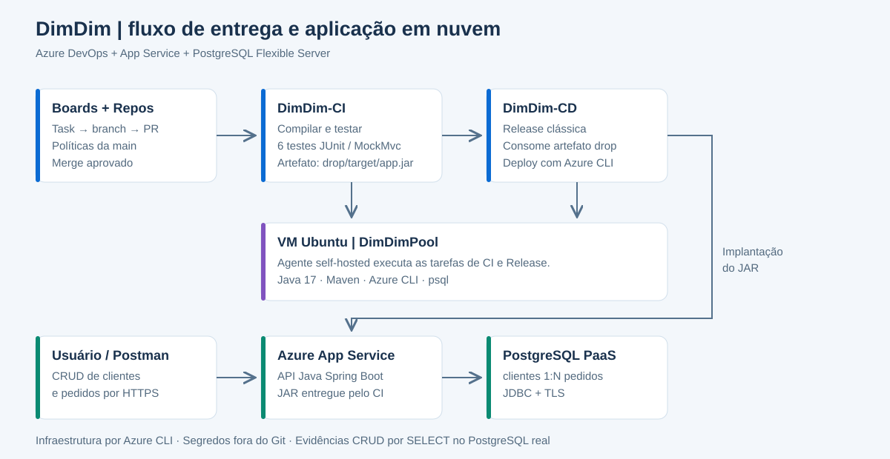

# DimDim — gestão de clientes e pedidos

API Java do **3º Checkpoint do 2º Semestre de DevOps Tools & Cloud Computing — FIAP**. A entrega utiliza **Azure DevOps Boards, Repos e Pipelines**, com build, testes e implantação automática. O destino da aplicação é o **Azure App Service**, com **PostgreSQL Flexible Server** na nuvem. A VM Ubuntu é utilizada para executar os comandos e o agente do Azure DevOps.



## 1. Descrição da solução

O DimDim permite cadastrar clientes e acompanhar seus pedidos. As tabelas `clientes` e `pedidos` possuem relacionamento **1:N**, com chave estrangeira e operações completas de inclusão, consulta, alteração e exclusão.

O projeto utiliza Java 17, Spring Boot, Maven e PostgreSQL. O endpoint `/api/versao` permite verificar na aplicação publicada a alteração feita durante a demonstração do CI/CD. O código é específico deste checkpoint; o formato da documentação segue a Sprint 3 como referência.

## 2. Benefícios para o negócio

A solução centraliza os dados de clientes e pedidos, reduz inconsistências e mantém a associação de cada pedido ao seu cliente. A automação executa testes antes da entrega e publica o mesmo pacote gerado pelo build, permitindo rastrear a mudança desde a tarefa até a aplicação em nuvem.

## 3. Arquitetura e funcionamento

| Recurso | Responsabilidade |
| --- | --- |
| Azure Boards | Task atribuída ao integrante e vinculada à branch e ao PR. |
| Azure Repos | Código Git, políticas da main e revisão por pull request. |
| VM Ubuntu 24.04 | Ambiente de trabalho e agente self-hosted do pool `DimDimPool`. |
| Pipeline `DimDim-CI` | Compila, executa seis testes e publica o artefato `drop`. |
| Release `DimDim-CD` | Consome o JAR do CI e implanta automaticamente no App Service. |
| Azure App Service | Executa a API Java e fornece o endereço HTTPS externo. |
| PostgreSQL Flexible Server | Armazena as duas tabelas relacionadas, com acesso TLS. |

Fluxo: Task → branch → alteração Java → PR → merge na main → CI com testes → artefato → Release automática → aplicação atualizada. O usuário acessa a API por HTTPS, e a aplicação manipula o PostgreSQL usando as configurações de ambiente do App Service.

Os scripts criam a infraestrutura. A configuração inicial de Boards, agente, políticas, Service Connection e Release é realizada no Azure DevOps, conforme as seções abaixo.

## 4. Estrutura do projeto

| Caminho | Conteúdo |
| --- | --- |
| `src/main/` | Código da API Spring Boot e configuração por ambiente. |
| `src/test/` | Seis testes automatizados com JUnit, MockMvc e H2. |
| `pom.xml` | Dependências e build Maven. |
| `script.sql` | DDL das tabelas, PK, FK e índice. |
| `azure-pipeline.yml` | Compilação, testes publicados e artefato do CI. |
| `scripts/00-configurar-ambiente.sh` | Nomes dos recursos e variáveis sem senhas. |
| `scripts/01-criar-vm.sh` | Criação de VM de apoio por Azure CLI, se necessária. |
| `scripts/02-preparar-vm-existente.sh` | Ferramentas de desenvolvimento e consulta SQL. |
| `scripts/03-criar-appservice.sh` | App Service, plano e PostgreSQL por Azure CLI. |
| `scripts/04-inicializar-banco.sh` | Executa o DDL no banco em nuvem. |
| `scripts/05-testar-cloud.sh` | Verifica saúde, versão e endpoints publicados. |
| `scripts/06-consultar-banco.sh` | SELECTs diretos no PostgreSQL em nuvem. |
| `scripts/07-excluir-recursos.sh` | Exclusão do grupo com confirmação, após correção. |
| `scripts/deploy-appservice.sh` | Deploy do JAR consumido pela Release. |
| `scripts/demonstrar-crud.py` | CRUD com SELECT e pausa após cada operação. |
| `docs/arquitetura-azure.svg` | Desenho dos recursos e fluxo de entrega. |
| `docs/consultas-evidencia.sql` | Consultas SQL para comprovação de CRUD. |
| `docs/roteiro-video.md` | Sequência da gravação. |
| `docs/validacao.md` | Verificações executadas e limitações. |
| `docs/atualizar-repositorio.md` | Como substituir a versão anterior deste pacote. |
| `postman/` | Coleção das dez operações HTTP com captura dos IDs. |
| `json/` | Corpos JSON para criação e atualização. |
| `Dockerfile` e `docker-compose.yml` | Validação local opcional; não usados no deploy App Service. |

## 5. Pré-requisitos

- Assinatura Azure ativa e permissão para criar os recursos.
- Organização Azure DevOps com permissão para criar projeto, pool, pipelines e conexão Azure.
- VM Ubuntu 24.04 x64, recomendados 2 vCPUs e 4 GB de RAM, ou Cloud Shell para provisionamento.
- Git, Java 17, Maven, Python 3, cliente PostgreSQL e Azure CLI.
- Nomes globalmente únicos para App Service e PostgreSQL.

App Service, banco, VM e discos podem gerar cobrança. Confira a assinatura antes de criar os recursos. Use dados fictícios nesta API acadêmica, que não inclui autenticação de usuários.

## 6. Azure DevOps, repositório e clone

### 6.1 Projeto e Task

Crie o projeto **DimDim-Checkpoint**, controle de versão **Git**, processo **Agile**. No Boards crie a Task **Implementar DimDim no Azure DevOps**, atribua ao seu usuário e altere o estado para **Active**. Anote seu ID.

Em Repos importe o repositório existente, se ele estiver no GitHub. Um repositório somente no GitHub não substitui o Azure Repos exigido neste trabalho.

### 6.2 Clone na VM

Na página Repos > Clone, copie a URL real e substitua o valor abaixo:

```bash
git clone URL_REAL_DO_AZURE_REPOS checkpoint-dimdim
cd checkpoint-dimdim
```

Se a pasta já existe e está clonada, entre nela e atualize com `git pull --ff-only`, com a árvore de trabalho limpa. Não execute `git init` novamente nem clone dentro da própria pasta.

Para atualizar a versão anterior do pacote, siga [docs/atualizar-repositorio.md](docs/atualizar-repositorio.md).

### 6.3 Preparar as ferramentas da VM

```bash
bash scripts/02-preparar-vm-existente.sh
```

Saia do SSH e entre novamente. Volte à pasta do projeto e confira:

```bash
cd ~/checkpoint-dimdim
java -version
mvn -version
python3 --version
psql --version
az version
```

Se o Azure CLI não estiver instalado, siga a [instalação oficial para Ubuntu](https://learn.microsoft.com/cli/azure/install-azure-cli-linux?pivots=apt). Instale o CLI antes de iniciar o serviço do agente.

Se ainda precisar criar a VM, execute `scripts/01-criar-vm.sh` no Cloud Shell Bash, na pasta do projeto, informando `SSH_SOURCE_CIDR=SEU_IP_PUBLICO/32`. O script cria a VM no Azure; não é necessário executá-lo para uma VM que já existe. Aguarde `sudo cloud-init status --wait` na primeira inicialização.

## 7. Validação do código

```bash
mvn -B clean verify
```

Resultado esperado: **BUILD SUCCESS**, seis testes sem falhas e JAR em `target/app.jar`. Os testes utilizam H2 em modo PostgreSQL e cobrem os CRUDs, relacionamento e validações. O CRUD final deve ser comprovado no PostgreSQL real em nuvem.

Docker Compose é apenas uma opção de teste local: configure `.env` a partir de `.env.example` e execute `docker compose -p dimdim up --build -d`. Essa etapa não faz parte do deploy App Service nem substitui a demonstração em nuvem. Não envie `.env` ao Git.

## 8. Infraestrutura completa na Azure via CLI

### 8.1 Login, assinatura e nomes

Execute na VM ou no Cloud Shell, na raiz do projeto:

```bash
az login --use-device-code
az account show --output table
# Se necessário:
# az account set --subscription "NOME-OU-ID-DA-ASSINATURA"

source scripts/00-configurar-ambiente.sh
```

O script define os nomes `dimdim-rm563489cp3` e `pg-dimdim-rm563489cp3`. Se já estiverem ocupados, escolha outro sufixo **antes de criar os recursos**:

```bash
export DIMDIM_SUFFIX=rm563489cp3b
unset APP_NAME PG_SERVER
source scripts/00-configurar-ambiente.sh
```

Use apenas letras minúsculas, números e hífen nos nomes. Guarde os nomes escolhidos: novas sessões devem usar os mesmos valores.

### 8.2 Senha somente na sessão

```bash
read -rsp 'Senha forte do PostgreSQL: ' DB_PASSWORD; echo
export DB_PASSWORD
export PGPASSWORD="$DB_PASSWORD"
```

Digite uma senha forte própria, sem registrá-la em arquivo, histórico ou vídeo. O script configura as credenciais no App Service, fora do código-fonte.

### 8.3 Criar os recursos e inicializar o banco

```bash
bash scripts/03-criar-appservice.sh
bash scripts/04-inicializar-banco.sh
```

Execute a criação uma vez; em caso de falha, examine o erro e os recursos já criados antes de repetir. O DDL utiliza `CREATE TABLE IF NOT EXISTS`. Alterações futuras de esquema exigem migração explícita.

O PostgreSQL aceita conexão TLS de serviços Azure por uma regra especial `0.0.0.0`. Essa regra abrange também outras assinaturas Azure, com autenticação obrigatória; não é uma regra aberta para toda a Internet. Conexão de computador fora do Azure exige regra restrita ao seu IP. Para uso em produção, adote uma rede privada ou restrinja os endereços efetivos de saída do aplicativo.

### 8.4 Conferir os recursos

```bash
az resource list --resource-group "$RG" --output table
az webapp show --resource-group "$RG" --name "$APP_NAME" \
  --query '{Nome:name,Estado:state,Endereco:defaultHostName}' --output table
az postgres flexible-server show --resource-group "$RG" --name "$PG_SERVER" \
  --query '{Nome:name,Estado:state,FQDN:fullyQualifiedDomainName}' --output table
```

Mostre também no Portal Azure os recursos criados pelos scripts. A aplicação só estará disponível depois da primeira Release.

## 9. Agente e Pipeline de Build — CI

### 9.1 Agente self-hosted na VM

Em Organization settings > Agent pools crie **DimDimPool**, tipo Self-hosted. Autorize o pool no projeto. Em New agent > Linux x64, siga os comandos atuais de download exibidos pelo Azure DevOps.

Instale em `~/azagent`, fora do repositório. Execute `config.sh` como usuário normal da VM, usando a URL real da organização, pool **DimDimPool** e um PAT temporário com escopo **Agent Pools — Read & manage**, conforme solicitado para registro. Não salve o PAT em arquivos do projeto.

Depois de configurar o agente:

```bash
sudo ./svc.sh install "$USER"
sudo ./svc.sh start
```

Confirme o agente **Online** no pool. Não registre o serviço como root. O Java, Maven e Azure CLI precisam estar instalados e disponíveis para o usuário do serviço. O pool deste projeto deve ter o agente da VM preparada.

### 9.2 Criar e testar o CI

Em Pipelines > New pipeline:

1. Selecione Azure Repos Git e o repositório.
2. Escolha Existing Azure Pipelines YAML file.
3. Selecione `/azure-pipeline.yml` e salve como **DimDim-CI**.
4. Autorize o uso do pool, se solicitado.
5. Execute Run pipeline manualmente.

Confirme logs verdes, seis testes publicados em **Tests** e artefato **drop**, contendo `target/app.jar`, DDL e script de deploy. Se a execução ficar aguardando, verifique o agente, a autorização do pool e a capacidade de jobs da organização.

## 10. Pipeline de Release — CD

### 10.1 Conexão com a assinatura Azure

Em Project settings > Service connections crie uma conexão **Azure Resource Manager**, preferencialmente **Workload identity federation**. Selecione a assinatura correta e o grupo de recursos do projeto. Nome: **sc-dimdim-azure**. Autorize somente a pipeline necessária.

A conexão precisa de permissão para implantar no App Service. Caso não consiga criá-la, o administrador da assinatura deverá conceder as permissões necessárias.

### 10.2 Release clássica

Em Pipelines > Releases > New pipeline > Empty job:

1. Adicione artefato do tipo **Build**, pipeline **DimDim-CI**, Latest, alias exatamente **ci**.
2. No raio do artefato, habilite **Continuous deployment trigger**, filtrando **main**.
3. Nomeie o stage **Azure-AppService** e mantenha execução automática após a criação da Release.
4. Em Tasks > Agent job, escolha **DimDimPool** e mantenha o download do artefato `ci` habilitado.
5. Em Variables, crie **RG** e **APP_NAME** com os nomes reais definidos na seção 8.
6. Adicione a tarefa **Azure CLI**, versão 2, conexão **sc-dimdim-azure**, Script type **Bash**, Script location **Inline script**:

```bash
set -euo pipefail
export RG='$(RG)'
export APP_NAME='$(APP_NAME)'
bash "$(System.DefaultWorkingDirectory)/ci/drop/scripts/deploy-appservice.sh"
```

Use nomes Azure válidos nos campos. A senha do banco já está no App Service e não precisa ser repassada à Release.

Salve como **DimDim-CD** e teste manualmente com **Create release**. A Release publica o JAR do CI; não recompila o código. Se a criação de Releases clássicas estiver desabilitada, um administrador precisa habilitá-la nas configurações de Pipelines.

### 10.3 Testar o aplicativo publicado

Na sessão da VM com os nomes configurados:

```bash
bash scripts/05-testar-cloud.sh
```

URL da aplicação: `https://NOME_REAL_DO_APP.azurewebsites.net/api/versao`. Confirme saúde `UP` e endpoints acessíveis. Não avance para a gravação se o CI manual ou a Release manual ainda estiverem falhando.

## 11. Branch, políticas e execução de ponta a ponta

### 11.1 Vincular a branch à Task

Abra a Task em Boards > Development > Create branch. Nome **feature/checkpoint**, base **main**. Confirme que o vínculo foi criado.

Em Repos > Branches > main > Branch policies configure:

- Um revisor mínimo.
- Permitir aprovação pelo próprio solicitante, conforme demonstração individual pedida pelo professor.
- Work Item vinculado obrigatório.
- Seu usuário, identificado com RM, como revisor padrão obrigatório.

Não habilite uma restrição que impeça sua aprovação individual quando for executar o fluxo solicitado. Validação de PR no Azure Repos, se adicionada, deve ser configurada em Build validation da política.

### 11.2 Alteração real no Java

**Comece a gravar antes desta etapa.** Na VM:

```bash
git fetch origin
git switch feature/checkpoint
# Se a branch existe apenas no remoto:
# git switch --track origin/feature/checkpoint
```

Em `src/main/java/br/com/fiap/dimdim/ApiController.java`, altere a mensagem do endpoint `/api/versao` de **DimDim em nuvem** para **DimDim atualizado pelo CI/CD**.

```bash
git diff
mvn -B clean verify
git add src/main/java/br/com/fiap/dimdim/ApiController.java
git commit -m "Atualiza mensagem da API AB#NUMERO_REAL_DA_TASK"
git push -u origin feature/checkpoint
```

Substitua `NUMERO_REAL_DA_TASK` pelo ID real. Alterar apenas README não atende essa evidência.

### 11.3 PR e pipelines automáticas

Abra PR **feature/checkpoint → main**, confira o Work Item vinculado, aprove e conclua. **Desmarque a exclusão da branch** e marque a conclusão dos Work Items associados.

Mostre a Task concluída e a sequência automática: merge → Build → testes publicados → artefato → Release → implantação. Abra logs das tarefas e depois consulte a URL externa para mostrar a nova mensagem no aplicativo. Nesta demonstração, não substitua o disparo automático por Run pipeline/Create release manual.

## 12. CRUD completo das duas tabelas

Importe [postman/DimDim.postman_collection.json](postman/DimDim.postman_collection.json) e configure `baseUrl` com a URL HTTPS do App Service. A coleção captura os IDs criados.

Também é possível executar os comandos abaixo na VM. Use os IDs retornados pela API; o banco não precisa começar em 1.

### 12.1 Clientes

```bash
# CREATE
curl -i -X POST "$BASE_URL/api/clientes" \
  -H 'Content-Type: application/json' \
  -d '{"nome":"Bruno Ferreira","email":"bruno.demo@exemplo.com"}'

# Informe o ID retornado no POST.
export CLIENTE_ID=ID_REAL_DO_CLIENTE

# READ geral e individual
curl -fsS "$BASE_URL/api/clientes"
curl -fsS "$BASE_URL/api/clientes/$CLIENTE_ID"

# UPDATE
curl -i -X PUT "$BASE_URL/api/clientes/$CLIENTE_ID" \
  -H 'Content-Type: application/json' \
  -d '{"nome":"Bruno Atualizado","email":"bruno.demo@exemplo.com"}'
```

### 12.2 Pedidos

```bash
# CREATE vinculado ao cliente real
curl -i -X POST "$BASE_URL/api/pedidos" \
  -H 'Content-Type: application/json' \
  -d "{\"clienteId\":$CLIENTE_ID,\"descricao\":\"Pedido inicial\",\"valor\":150.00}"

# Informe o ID retornado no POST.
export PEDIDO_ID=ID_REAL_DO_PEDIDO

# READ geral e individual
curl -fsS "$BASE_URL/api/pedidos"
curl -fsS "$BASE_URL/api/pedidos/$PEDIDO_ID"

# UPDATE
curl -i -X PUT "$BASE_URL/api/pedidos/$PEDIDO_ID" \
  -H 'Content-Type: application/json' \
  -d "{\"clienteId\":$CLIENTE_ID,\"descricao\":\"Pedido atualizado\",\"valor\":250.00}"

# DELETE do pedido primeiro
curl -i -X DELETE "$BASE_URL/api/pedidos/$PEDIDO_ID"

# DELETE do cliente após excluir o pedido
curl -i -X DELETE "$BASE_URL/api/clientes/$CLIENTE_ID"
```

POST retorna 201, GET/PUT 200 e DELETE 204. Dados inválidos retornam 400, registros ausentes 404 e conflitos 409. Um cliente com pedidos não pode ser excluído; e-mails de clientes não podem se repetir.

## 13. Evidência direta no PostgreSQL por SELECT

**Após cada operação da seção anterior**, execute:

```bash
export PGPASSWORD="$DB_PASSWORD"
bash scripts/06-consultar-banco.sh
```

As consultas de [docs/consultas-evidencia.sql](docs/consultas-evidencia.sql) mostram as duas tabelas e seu relacionamento. Confirme registro inserido após POST, dados alterados após PUT e ausência do registro após DELETE. Mostre também os GETs e a consulta correspondente. O cliente `psql` está conectado ao banco PaaS real, não ao H2 de testes.

Para automatizar a sequência com pausas e SELECTs após cada operação:

```bash
python3 scripts/demonstrar-crud.py
```

O script utiliza os IDs reais retornados pela API e um e-mail de demonstração único. Exclui apenas os registros que ele mesmo criou, ao final. Se for interrompido, os registros já criados permanecem no banco. Escolha a sequência manual **ou** o script e mostre todas as evidências no vídeo.

Em uma nova sessão, execute novamente `source scripts/00-configurar-ambiente.sh` com os nomes corretos e informe a senha por `read -rsp`, conforme a seção 8. Não digite a senha visivelmente na gravação.

## 14. Integrantes

| Nome completo | RM |
| --- | --- |
| Hebert Lopes do Santos | 563192 |
| Nicolas Monteiro Ramiro | 562380 |
| Marcus Vinícius Vila Nova da Silva | 558771 |
| Bruno Ferreira | 563489 |
| Gabriel Robertoni Padilha | 566293 |

**Instituição:** FIAP · **Curso:** Análise e Desenvolvimento de Sistemas · **Disciplina:** DevOps Tools & Cloud Computing · **Professor:** João Menk.

## 15. Vídeo, acesso do professor e entrega

Siga [docs/roteiro-video.md](docs/roteiro-video.md). Grave em no mínimo 720p, explicando a alteração Java, o PR, as pipelines automáticas, os testes publicados, a aplicação em nuvem e o CRUD com SELECTs no banco.

Inclua `pf0841@fiap.com.br` na organização com licença Basic e garanta acesso ao projeto. O PDF menciona administrador e Contributor no mesmo trecho; confirme com o professor o grupo esperado e confira o acesso efetivo.

| Link | Preencher após execução |
| --- | --- |
| Projeto Azure DevOps | URL real do projeto |
| Aplicação | URL HTTPS real do App Service |
| Vídeo YouTube | URL real com acesso permitido ao avaliador |

Entregue **`<nomeGrupo>_pipelines.pdf`**, contendo capa com nome do grupo, nomes/RMs e links do Azure DevOps e do vídeo. O representante envia o PDF no Teams. DimDim é o nome do projeto; o nome do grupo deve ser definido pelos integrantes.

### Checklist da entrega

- [ ] Task atribuída, concluída e vinculada à branch/PR.
- [ ] Repos com código, `script.sql`, scripts, YAML e JSONs.
- [ ] Main protegida com as políticas solicitadas.
- [ ] PR aprovado, branch preservada e Task concluída no merge.
- [ ] CI executado automaticamente, com seis testes publicados.
- [ ] Release automática consumindo o artefato do CI.
- [ ] App Service e PostgreSQL criados por scripts e mostrados no Portal.
- [ ] CRUD completo de clientes e pedidos com SELECTs em nuvem.
- [ ] Configurações sensíveis fora do Git e fora da gravação.
- [ ] Professor com acesso na organização e no projeto.
- [ ] Vídeo em pelo menos 720p e links acessíveis.
- [ ] PDF no padrão solicitado enviado pelo representante.

Os itens devem ser marcados somente após a execução real na sua conta. A compilação e os seis testes foram verificados; implantação e permissões precisam ser validadas no ambiente do grupo. Consulte [docs/validacao.md](docs/validacao.md).

## 16. Exclusão dos recursos após a correção

Somente quando não precisar mais manter a entrega e depois de preservar os dados necessários:

```bash
source scripts/00-configurar-ambiente.sh
bash scripts/07-excluir-recursos.sh
```

O script solicita o nome exato do grupo e o Azure CLI pede confirmação. Excluir o grupo remove todos os seus recursos e dados. A VM só será removida se também estiver dentro desse grupo. Após concluir os comandos com segredos, limpe as variáveis da sessão com `unset DB_PASSWORD PGPASSWORD`.
